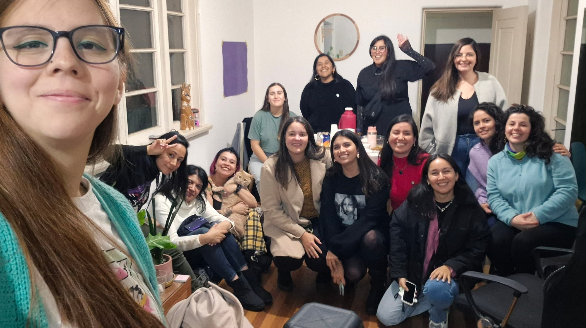
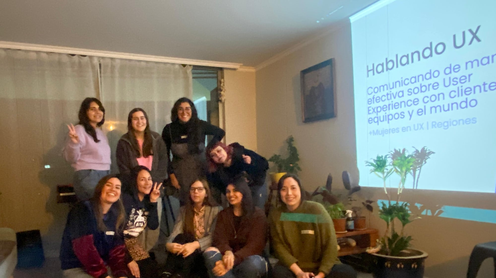
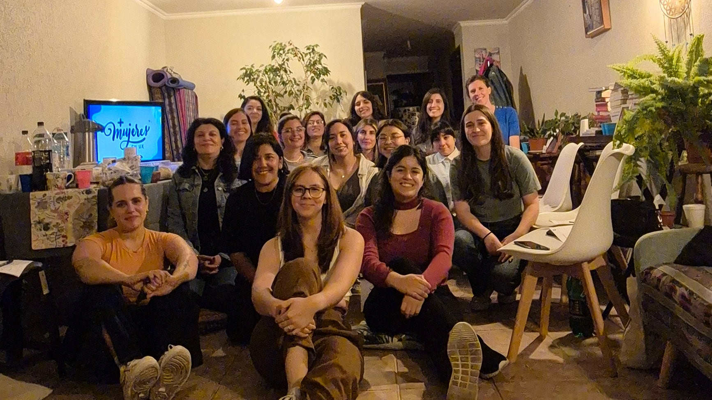
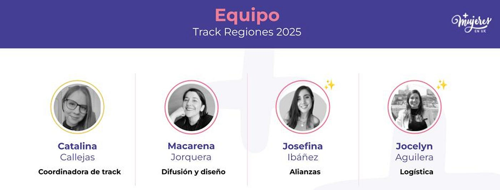

Cuando comencé en el mundo laboral, sentí que quizás el camino iba a ser un poco solitario.
Especialmente porque vivía en una región donde no había vivido antes y, por lo tanto, no conocía
tanta gente. Tenía un trabajo a distancia, la mayoría de mis compañeras vivían en Santiago y obvio
tocaba ir cada cierto tiempo a reuniones. Como siempre he dicho, “Santiago tira”.

Hoy, sigo trabajando a distancia, yendo a reuniones a Santiago, viviendo el día a día a través de
una pantalla. Pero **me equivoqué muchísimo cuando pensé que el camino sería solitario, porque no lo
ha sido.** He ido poco a poco, conociendo otras mujeres que viven experiencias similares a la mía
que, en un país tan centralizado como Chile, deciden por una u otra razón trabajar desde regiones.

Y, es acá, donde surge el primer tema de este artículo: lo interseccional. Como mujeres, ya sabemos
que el solo hecho de nuestro género implica un factor de discriminación. No obstante, al género se
pueden sumar diversas causas que dificultan nuestras experiencias; estas pueden ser nuestra
orientación sexual, color de piel, etc. En este caso, hablaremos del lugar en el que habitamos. **En
un país como Chile, donde Santiago lo es todo, trabajar desde una región que no es la capital, se
vuelve un desafío.** Y es en base a eso que como **+Mujeres en UX Chile decidimos hacernos parte y
proponer un nuevo espacio diseñado para y por nosotras, las mujeres que vivimos en regiones.**

## 1ra etapa: Definiendo y empatizando

Todo comenzó a fines del año 2023, cuando pregunté por qué todos los encuentros de la comunidad eran
en Santiago. Desde que entré en el mundo del UX había mirado a la comunidad, pero por distancia
nunca había podido participar de manera activa. Ir a Santiago, incluso viviendo en Valparaíso,
implica un esfuerzo de tiempo (2–3 hrs viajando) y económico, por lo que muchas veces se termina
priorizando en donde participar. Este fue el primer acto de empatía: si yo, viviendo cerca de Stgo.,
no podía asistir, **¿qué quedaba para otras mujeres de regiones más lejanas? ¿Es justo tener que
abstenerse de instancias de tanto valor solo porque vives en otro lugar?** Tenía muchas preguntas,
por lo que me decidí a escribir a la comunidad y me recibieron con los brazos abiertos. No me di ni
cuenta y ya estaba conversando con Consu y Tere, embajadoras de +M Chile 2022–2023. Tenía muchas
ideas, ganas y energía para entregar, por lo que me convertí en la líder del track regiones.

Así fue como llegamos a reunirnos por primera vez para esbozar cuál sería el camino. **Conversamos,
buscamos nuevas voluntarias y se conformó el Track Gestión regiones con Jenny, Maca y yo, Cata.** En
Valparaíso, 2024, ya consolidadas como un equipo, comenzamos a pensar cómo queríamos que fuera el
espacio. Nuestro piloto sería en la V región, porque teníamos más o menos una noción de que habían
muchas mujeres habitando la región. Había que partir por alguna parte sin dejar de pensar en que
esto luego se expandiría a otras regiones. Sin embargo, teníamos muchas preguntas: ¿Queremos algo
más cálido o más formal? ¿Algo íntimo o masivo? ¿Qué necesitábamos realmente como mujeres UX en
regiones?

Poco a poco todo se fue definiendo para ya atrevernos a dar el siguiente paso: queríamos conocer a
las mujeres de nuestra querida V región. Así, convocamos a una primera reunión donde todo fluyó de
una manera indescriptible. Y sí, sé que suena exagerado, pero no se imaginan lo precioso y sororo
que fue ese primer encuentro. **Con 20 participantes, en casa de Maca, logramos conocernos, definir
desafíos y expectativas.** Pudimos empatizar las unas con las otras y ver que el camino que
pensábamos tomar era el que se necesitaba. Incluso creamos nuestro primer grupo de Whatsapp de +M V
región.

_1er encuentro 2024: Compartamos un café, Valparaíso._

## 2da etapa: Ideando, prototipando y probando

Habiendo ocurrido este primer encuentro y conociendo las expectativas, el camino continuó. Ya no era
solo un encuentro sino que tres. Tuvimos una hermosa **completada invernal** donde conversamos y
debatimos sobre cómo comunicar nuestras ideas, esta vez nos reunimos en un ambiente cálido, en casa
de una de las asistentes al primer encuentro. Comimos, nos reímos y, lo principal, volvimos a
destacar que no estamos solas.

_2do encuentro 2024: Completada, Viña del Mar._

En nuestro **3er encuentro del año, nos acompañó Carolina Sepúlveda, fundadora de +M** quien nos
contó todos sus secretos sobre negociación en una conversación fluida y cálida. Comimos rico, como
siempre. En casa de Joy, quien también puso la casa en el encuentro anterior y quien luego se
convertiría en parte del equipo.

_3er encuentro 2024: Experiencias y negociación, Viña del Mar._

## 3ra etapa: Probando probando, parece que resulta

Luego de un 2024 con 3 encuentros exitosos, el equipo cambió. Jenny partió a Santiago y decidimos
que era necesario ampliar el track. Nos volcamos en la búsqueda, entrevistamos a excelentes
postulantes y tomamos una decisión con base en los objetivos 2025. De esta forma se incorporaron Joy
en el área logística y, por otro lado, Jo quien se sumó para pensar el track más allá: **porque las
regiones no son solo Valparaíso, queremos seguir creciendo.**

_Equipo Track regiones 2025._

Con el track consolidado como equipo de trabajo, decidimos continuar. Este año 2025 tenemos dos
objetivos:

- **Continuar con los encuentros en la V región según las necesidades del grupo.**
- **Expandirnos y continuar creciendo para que haya +M en todo Chile.**

¿Cumpliremos? Eso esperamos, con todo el corazón. Porque es justamente eso lo que cada voluntaria le
pone a su trabajo: corazón. Este 2025 toca seguir remando, con un equipo más amplio y diverso que,
sin dudas, podrá levantar a la organización en más lugares. Porque, quizás, nos falta construir
puentes. **Pero, ¿Solas? Jamás.**
